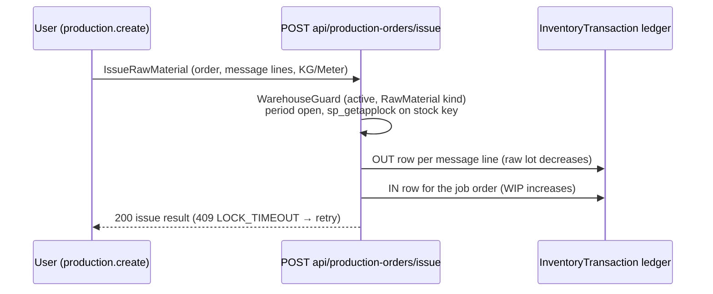
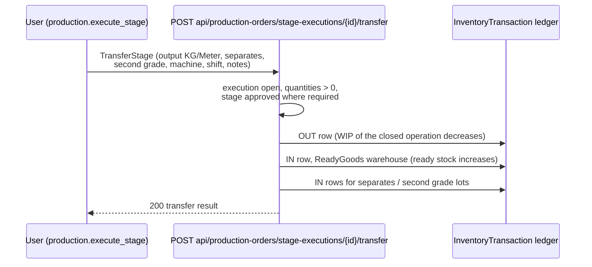
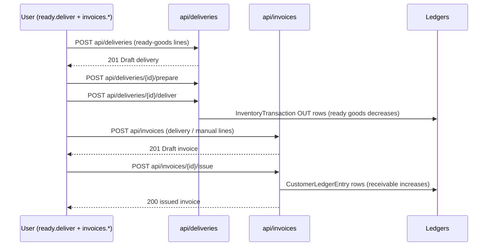
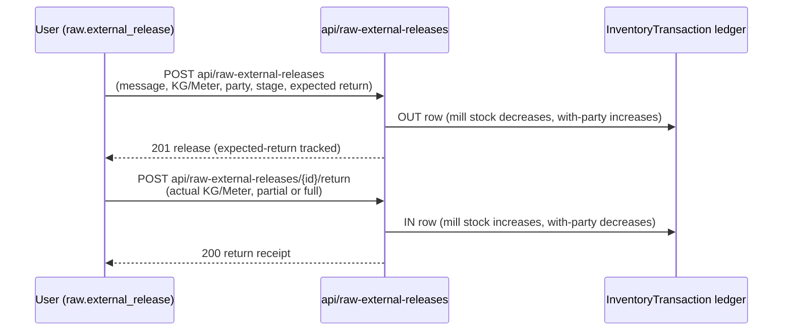
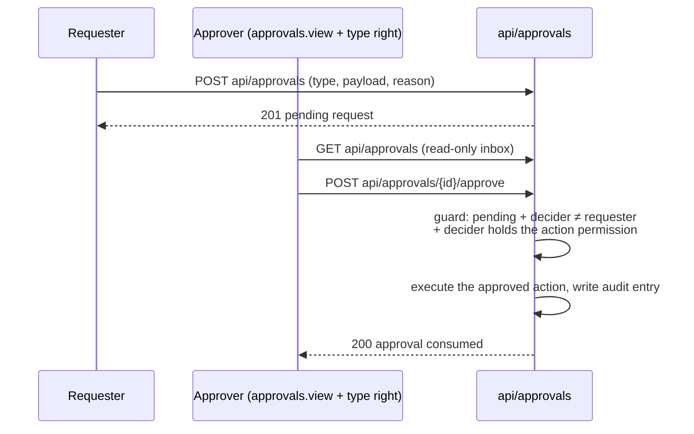

# Core workflows — endpoints and ledger effects

How the five central flows move through the API: which endpoints the client calls,
in what order, and which append-only ledger rows each step writes. Balances are
never stored — every quantity below is a row in `InventoryTransaction`
(fabric), `MaterialTransaction` (chemicals), `CustomerLedgerEntry`,
`SupplierLedgerEntry` or `TreasuryTransaction`; corrections are linked reversal
rows, never edits.

Conventions used in every diagram:

- `API` is `api/...` under the same host; all calls carry the session (cookies or
  `Authorization: Bearer`) and the permission named in the endpoint's summary.
- `409 CONCURRENT_UPDATE` means "reload and retry"; `409 LOCK_TIMEOUT` means
  "someone else holds the stock lock — retry in a moment". Both are normal, not
  server faults (see `docs/api/errors.md`).

## 1. Issue raw material to a job order

The user picks the exact raw message(s) and quantities — there is no FIFO and
nothing is auto-picked. The issue moves fabric from the raw lot into production
(WIP) on the ledger.

Net effect: the raw message's live remaining drops; the order's WIP rises by the
same KG/Meter. (Chemical/material issues are reversed with
`POST api/material-issues/{id}/cancel`, which posts a compensating IN row and
keeps the original OUT row — permission `production.issue_material_cancel`.)

## 2. Stage transfer to ready goods

Closing a stage execution moves finished output into the ready-goods store. The
transfer is the ONLY production transaction: every fact (input, output, waste,
separates, second grade, machine, shift) belongs to the operation being closed.

Ready-goods balance per job order is a live sum over these rows
(`GET api/ready-goods/balance`). `POST api/ready-goods/transfers` moves stock
between ready-goods lots without touching production.

## 3. Delivery and invoice

Deliveries run Draft → Prepared → Delivered; delivering deducts ready goods.
Invoices post to the customer ledger on issue; cancelling either posts a linked
reversal referencing the original.

Cancellation (`POST .../{id}/cancel` on either) never deletes: it posts the
mirror rows and locks both documents.

## 4. External processing round trip

Customer-owned fabric leaves for a third-party processor and comes back. Each
leg names the source message — ownership stays on the ledger, never by editing
the original message.

`PUT .../{id}/external-processing` corrects the release terms;
`POST .../{id}/cancel` reverses an unreturned release. A raw sale and a return
to the customer are the same endpoint with a different release reason.

## 5. Approval with separation of duties

Sensitive operations (negative-stock override, cost approval, reprint-after-issue,
...) do not execute directly: they file a request, and a different user decides.
The requester can never approve their own request — enforced in
`ApprovalRequestGuard`, not in the UI.

`POST api/approvals/{id}/reject` closes the request without executing.
Approval rights are per action type (e.g. `inventory.approve_negative_stock`),
so the night-shift supervisor can approve stock overrides without holding the
keys to payroll.
